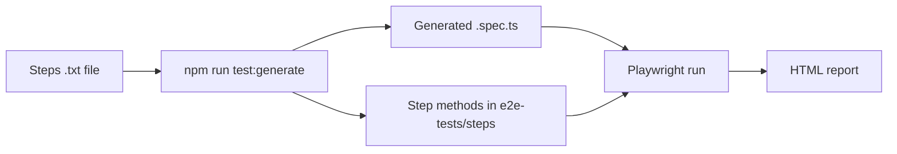

# Plain-Steps Test Case Generator - Demo Presentation

Write a test case in plain English, generate the Playwright spec and step methods, run it, and open the report.

## Before you start (once)

```powershell
npm ci
npx playwright install chromium
node -v    # must be 22.22 or later
```

## Slide 1 - The problem

- E2E tests are hand-coded: locators, assertions, boilerplate.
- Testers who do not code cannot contribute test cases.
- Result: slow authoring and inconsistent tests.

## Slide 2 - The idea

Plain steps in, working Playwright test and HTML report out.



## Slide 3 - Live demo A: the payroll example (with data tables)

1. Show the input, `e2e-tests/test-cases/payroll-duplicate-rows.txt`. Point out the two data tables.
2. Generate the spec:
   ```powershell
   npm run test:generate -- e2e-tests/test-cases/payroll-duplicate-rows.txt
   ```
3. Open `e2e-tests/generated/payroll-duplicate-rows.spec.ts`. Each step is a `test.step` that calls a method, and tables become typed records.
4. Open `e2e-tests/steps/payroll-steps.ts` to show the step methods.
5. Run it:
   ```powershell
   npx playwright test e2e-tests/generated/payroll-duplicate-rows.spec.ts
   ```
6. Open the report:
   ```powershell
   npm run test:e2e:report
   ```

Note: the payroll app is simulated in `payroll-steps.ts` so the demo runs anywhere. Replace the method bodies with real locators for a real app. Demo rule: rows with the same HIRE DATE and PAY DATE are duplicates, giving 1 error per duplicate group and 1 warning per duplicate row (2 warnings, 1 error here).

## Slide 4 - Live demo B: the real site

```powershell
npm run test:generate -- e2e-tests/test-cases/demo-navigation.txt
npx playwright test e2e-tests/generated/demo-navigation.spec.ts
```

This runs against the Tailspin Toys site (game page and 404 page).

## Slide 5 - Live demo C: unknown steps become stubs

```powershell
npm run test:generate -- e2e-tests/test-cases/custom-step-stub.txt
npx playwright test e2e-tests/generated/custom-step-stub.spec.ts
```

The run fails with "Step not implemented: I check the loyalty banner". Implement the stub, re-run, and it passes. To keep a new step permanently, add a method to `e2e-tests/steps/` and a pattern in `scripts/test-generator/generator.ts` (regenerating overwrites the generated file). Delete `e2e-tests/generated/custom-step-stub.spec.ts` afterwards so it does not fail the regular suite.

## Slide 6 - Quality

```powershell
npx vitest run scripts     # 13 unit tests for the parser and generator
npm run lint
npm run typecheck
```

## Slide 7 - Benefits and next steps

- Faster authoring, reusable steps, fewer locator mistakes.
- Readable step-by-step reports for stakeholders.
- Next: more built-in steps, AI-assisted step generation from free text, CI report publishing, optional Cucumber migration (the format is Gherkin-like).

## Cheat sheet: supported step syntax

| Step | Method |
| ---- | ------ |
| `I open "/path"` | `openPage` |
| `I click "name"` | `clickByName` |
| `I fill "label" with "value"` | `fillField` |
| `I should see text "x"` | `expectText` |
| `I should see heading "x"` | `expectHeading` |
| `I should be on "/path"` | `expectPath` |
| `the page title should be "x"` | `expectTitle` |
| Payroll steps (see `payroll-steps.ts`) | `navigateToPayroll`, `navigateToPayrollManagePage`, `editCombinedExcelFile`, `executePayrollUpload`, `verifyErrorCount` |

A `| a | b |` table under a step is passed to its method as `Record<string, string>[]`.
